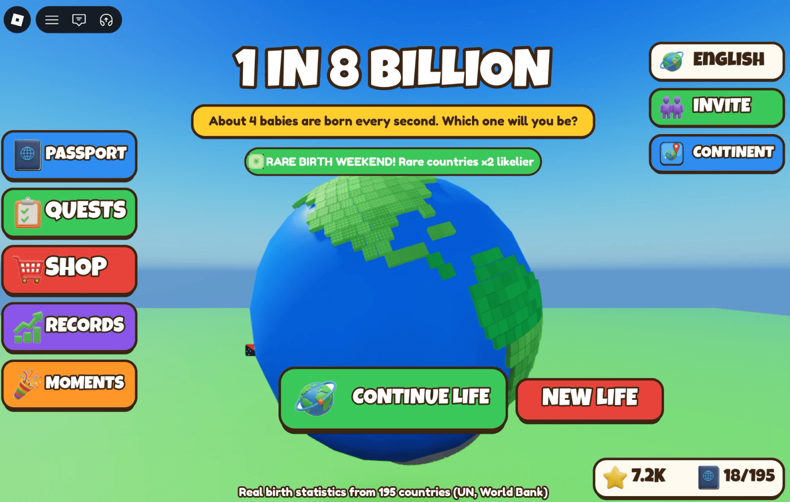
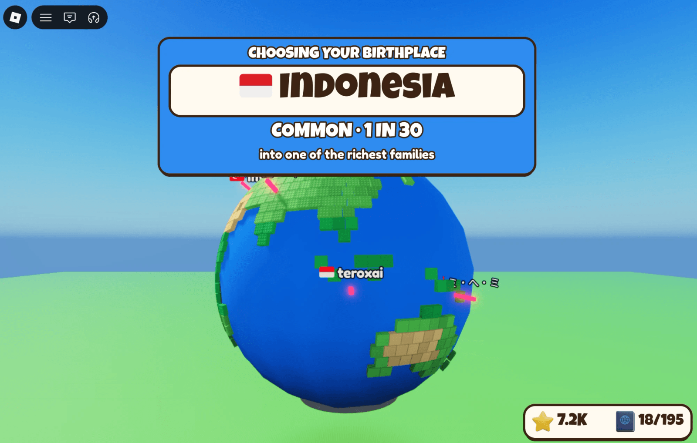
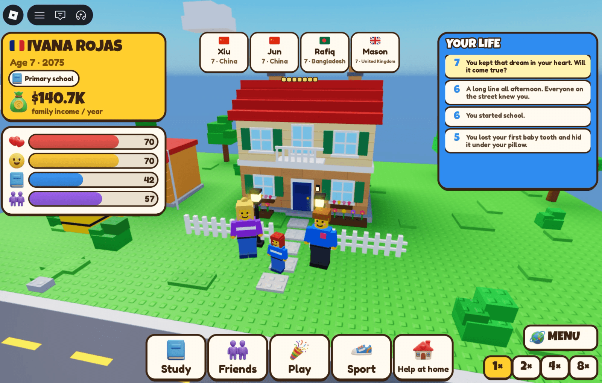
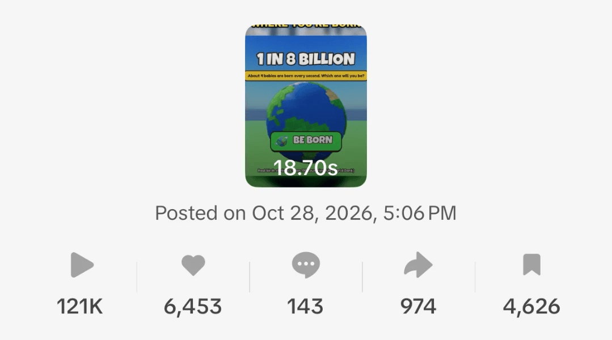
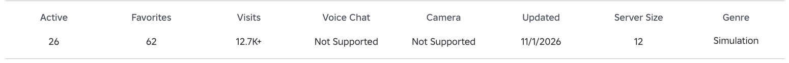
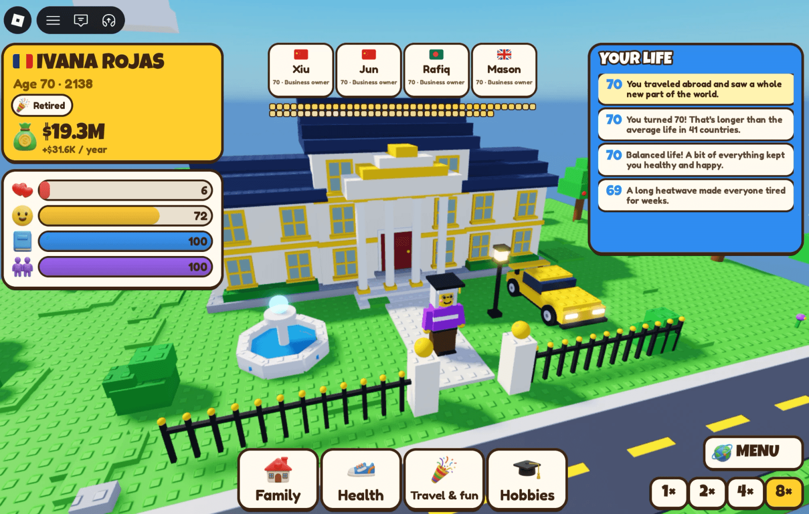

Ich mache Apps für Mac und iPhone. Letzte Woche habe ich ein Roblox-Spiel gemacht, vor allem aus Neugier. Von der Idee bis zur Veröffentlichung hat es zwei Tage gedauert, und in den ersten fünf Tagen kamen mehr als 12.700 Besuche.

So lief es: was die KI gemacht hat, was ich selbst reparieren musste und woher die Spieler kamen.

## Die Idee

Ich hatte gehört, wie Leute über ein Browserspiel sprachen, in dem man als eines von acht Milliarden Babys zufällig geboren wird und sieht, was für ein Leben man bekommt. Jemand aus meinem Umfeld, der Roblox spielt, fragte, ob das dort funktionieren würde. Ich dachte, eine einfachere Version schon.

Das Ergebnis ist [Born As: 1 in 8 Billion](https://www.roblox.com/games/89739743403211). Du drehst ein Geburtsrad mit echten Wahrscheinlichkeiten für 195 Länder: Indien kommt etwa jedes sechste Mal, San Marino etwa einmal in 900.000. Dann lebst du ein ganzes Leben in ein paar Minuten, Schule, Arbeit, Liebe, Familie, vielleicht ein Umzug ins Ausland, und vier andere Babys werden im selben Moment geboren, darunter echte Spieler auf deinem Server.

Die Geburtenzahlen stammen aus offenen Daten der UN und der Weltbank, und das Spiel sagt das auf dem Bildschirm.

## Zwei Tage, Roblox Studio mit Claude verbunden

Ich habe Roblox Studio über seinen MCP-Server mit Claude verbunden, damit der Agent das Spiel direkt lesen und ändern konnte. Er hat den Code in Luau geschrieben, die Oberfläche gebaut und die Übersetzungen gemacht. Die Bilder für die Spielseite und die Vorschauen habe ich mit einem anderen KI-Werkzeug gemacht.

Zwei Tage klingt schnell, und das war es. Es heißt aber nicht, dass die KI das Spiel gemacht hat, während ich zugeschaut habe.

## Was die KI nicht sehen konnte

Der Agent weiß, wie eine gute Oberfläche im Allgemeinen aussieht. Das Ergebnis sieht er nicht. Knöpfe lagen übereinander, manche waren viel zu klein, manche behielten das Standardaussehen. Auch die Logik hatte Lücken.

Die Lösung war einfach und langweilig: Ich habe auf den Bildschirm geschaut und ihm genau gesagt, was falsch ist. „Dieser Knopf ist zu klein.“ „Diese beiden überlappen.“ Sobald er es wusste, hat er es repariert und meistens auch die Regel dahinter verstanden.

Der größte Fehler war das Handy. Der Agent hat alles am PC getestet. Wir hatten vereinbart, auch auf Handys und Konsolen zu veröffentlichen, also habe ich nach dem Start das fertige Spiel auf dem Handy geöffnet. Alles war winzig und schief. Das bedeutete eine Runde Korrekturen nach dem Start, mit Spielern schon im Spiel.

Die Lehre ist dieselbe wie bei meinen Apps: Die KI schreibt schnell, ein Mensch muss jeden Bildschirm auf jedem Gerät ansehen.

## Woher die Spieler kamen

Fast alle kamen von TikTok. Ich habe für das Spiel [ein Konto](https://www.tiktok.com/@roblox_games_dragon) angelegt und kurze Clips gepostet. Einer ist durchgestartet: 121.000 Aufrufe, 6.453 Likes und 974 Mal geteilt, und 130 Leute sind dem Konto allein wegen dieses Videos gefolgt.

Die Leute haben nicht nur geschaut. Sie haben kommentiert: danke, tolles Spiel, wie finde ich es. Manche haben Fehler gemeldet, und ich habe sie am selben Tag behoben. Die Community hat mehr geholfen, als ich erwartet hatte.

Nach fünf Tagen hatte das Spiel 12.700 Besuche, 32 Likes und 3 Dislikes, war 62 Mal in den Favoriten, und das Abzeichen für die Geburt war fast 7.000 Mal vergeben.

## Was niemand vorher sagt: Kinder unter 16

Ein neues Roblox-Spiel ist nicht für alle offen. Zuerst wird es nur Spielern gezeigt, die bestätigt haben, dass sie 16 oder älter sind. Die meisten Roblox-Spieler sind jünger, das ist also ein großer Punkt.

Um das Spiel für Jüngere zu öffnen, verlangt Roblox einiges. Das Konto braucht einen verifizierten Ausweis und die Zwei-Schritt-Verifizierung. Das Spiel braucht eine Inhaltseinstufung über Roblox' Fragebogen, meines ist Minimal, für alle geeignet. Dann hältst du entweder zwei Monate lang ein Abo Roblox Plus oder Premium oder zahlst pro Spiel eine einmalige Veröffentlichungsgebühr. Ich habe die Gebühr gezahlt: 1.000 Robux, etwa 12 Euro. Laut Roblox wird sie 90 Tage, nachdem das Spiel freigeschaltet ist, erstattet.

Und dann muss sich das Spiel das verdienen. Es braucht innerhalb von 60 Tagen 250 einzelne Spielstarts von sogenannten stark engagierten Spielern. Das sind ältere, aktive Konten, die Zeit im Spiel verbracht und irgendwo auf Roblox etwas gekauft haben. TikTok-Aufrufe zählen dafür allein nicht, diese Spieler müssen kommen und bleiben. Die genauen Regeln stehen auf Roblox' Seite zu [Kids und Select](https://create.roblox.com/docs/production/publishing/kids-and-select), und sie ändern sich, also prüfe sie vorher.

## Mit KI gemacht?

Von Hunderten Kommentaren sagten zwei, das Spiel sei mit KI gemacht. Ich verstehe, woher das kommt, aber ich teile nicht, was damit gemeint ist.

Für mich heißt „mit KI gemacht“: ein Prompt und veröffentlicht. So war es nicht. Ich habe entschieden, was das Spiel ist, jeden Bildschirm geprüft, die Fehler gefunden, auf Geräten getestet und den Spielern geantwortet. Die KI hat getippt. Das ist kein Grund, sich zu schämen, sondern der Grund, warum eine Person ein Spiel in zwei Tagen veröffentlichen kann.

## Wie ein Roblox-Spiel Geld verdient

Roblox bietet ein paar Wege, im Spiel etwas zu verkaufen, und das Spiel nutzt sie: einmalige Käufe, etwa noch einmal geboren werden oder in einem gewählten Land, Pässe, die bleiben, und seit dieser Woche einen monatlichen Club. Zahlen veröffentliche ich nicht, wie in jedem Artikel hier. Es ist wenig, und es fing in den ersten Tagen an.

## Wenn du es versuchen willst

1. Verbinde Roblox Studio mit deinem KI-Agenten, damit er am echten Spiel arbeitet und nicht an kopiertem Code.
2. Fang mit einer Idee an, die sich in einem Satz erklären lässt. Meine passt auf den Startbildschirm.
3. Schau dir jeden Bildschirm selbst an und sag genau, was falsch ist. Der Agent sieht das Ergebnis nicht.
4. Teste vor dem Start auf dem Handy. Die meisten Roblox-Spieler sind auf dem Handy.
5. Mach einen kurzen Clip vom überraschendsten Moment. Bei mir war das das Geburtsrad, das auf einem seltenen Land landet.
6. Lies die Kommentare und behebe Fehler schnell. Frühe Spieler merken das.
7. Plane den Start ab 16 ein: Ein neues Spiel sehen zuerst ältere Spieler, und für Kinder brauchst du Verifizierung, Gebühr oder Abo und 250 stark engagierte Spieler.

## Fragen, die gestellt werden

### Kann man ein Roblox-Spiel mit KI machen?

Ja. Wenn Roblox Studio mit einem KI-Agenten verbunden ist, kann er den Luau-Code schreiben, die Oberfläche bauen und das Spiel übersetzen. Entwerfen, jeden Bildschirm prüfen und auf jedem Gerät testen musst du trotzdem selbst. Mein Spiel brauchte zwei Tage von der Idee bis zum Start.

### Was macht die KI bei Roblox-Spielen schlecht?

Sie sieht das Ergebnis nicht. Knöpfe überlappen, Größen stimmen nicht, und sie testet gern nur am PC. Sobald du das genaue Problem benennst, repariert sie es.

### Wie lange dauert ein Roblox-Spiel mit KI?

Ein einfaches Spiel lässt sich in ein paar Tagen veröffentlichen. Rechne nach dem Start mit einer weiteren Runde Korrekturen, vor allem für Handys.

### Wie bekommt man die ersten Spieler für ein Roblox-Spiel?

Bei mir war es TikTok: kurze Clips vom überraschendsten Moment im Spiel. Ein Clip mit 121.000 Aufrufen brachte fast alle frühen Spieler.

### Können Kinder unter 16 ein neues Roblox-Spiel sofort spielen?

Nein. Ein neues Spiel wird zuerst altersgeprüften Spielern ab 16 gezeigt. Für Jüngere brauchst du Ausweisprüfung, Zwei-Schritt-Verifizierung, eine passende Inhaltseinstufung, ein Abo Plus oder Premium oder eine erstattbare Veröffentlichungsgebühr sowie 250 einzelne Spielstarts von stark engagierten Spielern in 60 Tagen.

### Wie verdienen Roblox-Spiele Geld?

Mit Käufen im Spiel: einmalige Produkte, Pässe und Abos, bezahlt in Robux.
