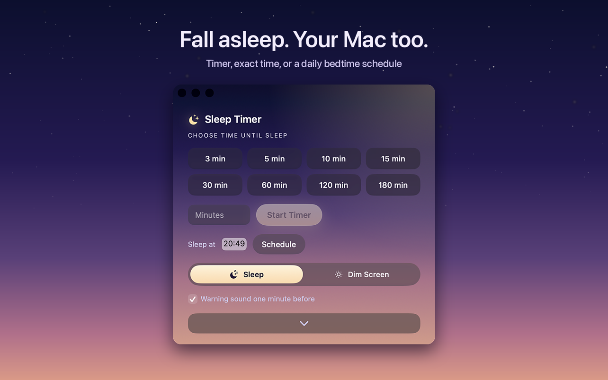
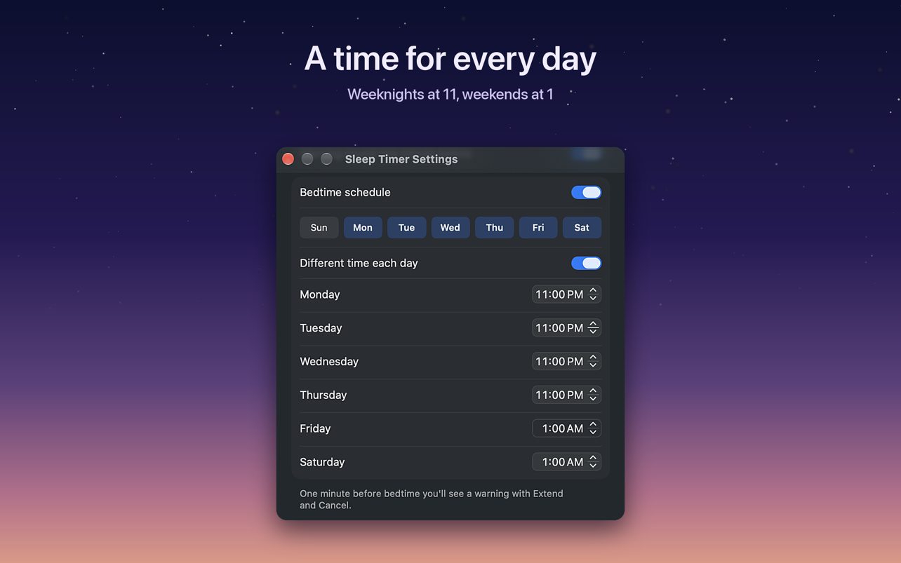
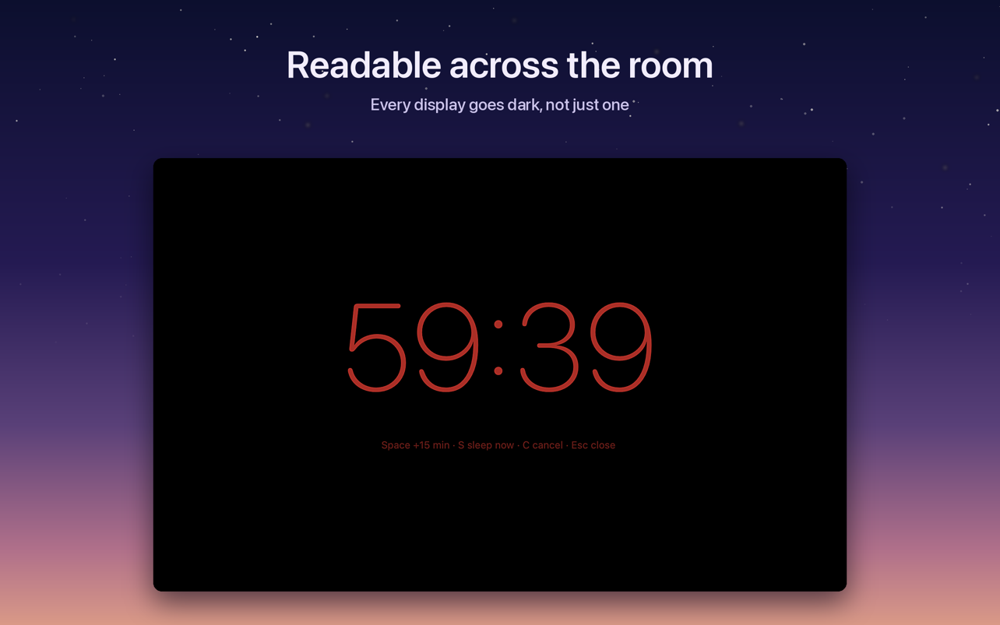
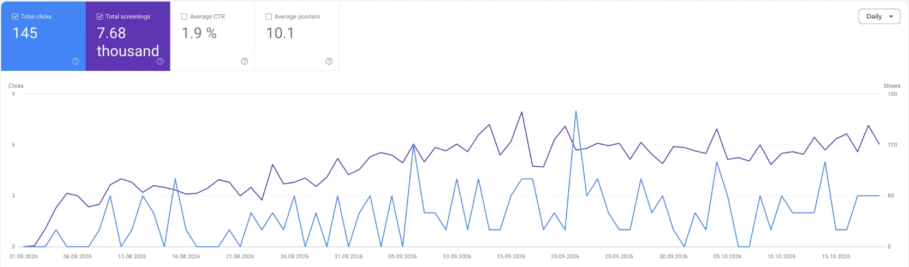
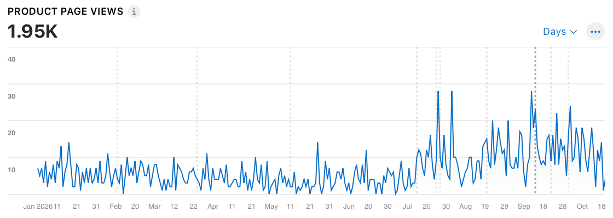
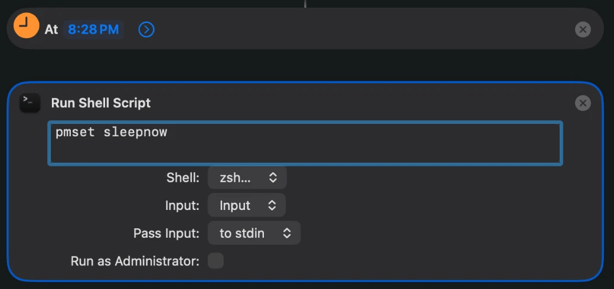
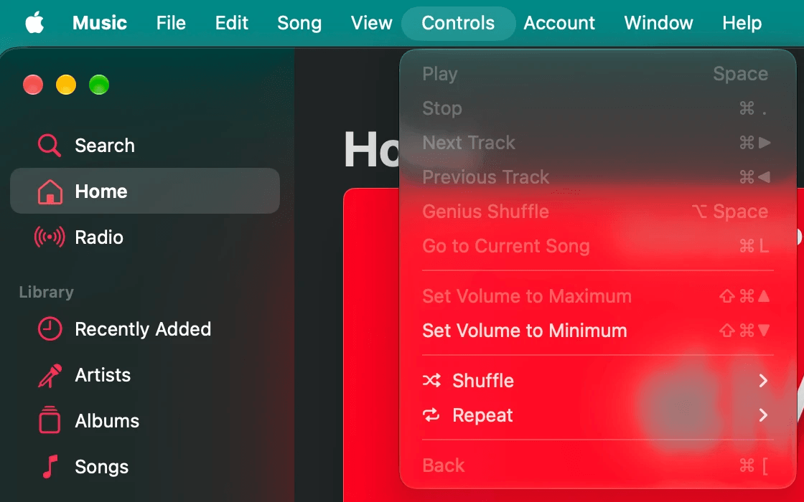

For a long time my evenings ended the same way. A series on the MacBook, lights off, and before I fell asleep I opened Terminal and typed a line like this:

```
sleep 3600 && pmset sleepnow
```

Wait an hour, then put the Mac to sleep. It works, but every single night, half asleep, typing a command into a black window. The Mac has no sleep timer. Apple even removed the old sleep schedule from the settings. So in 2024 I built one, and it became my first app: [Sleep Timer](/apps/sleep-timer/), [$2.99 once on the Mac App Store](https://apps.apple.com/app/id6502469655).

This is how it went from a week-long side project to version 4.6, and at the end, the free ways to do the same thing if you do not want an app at all.

## Version one: a week in Flutter

I wrote the first version myself in Flutter, because Flutter was what I knew. It took about a week. A menu bar icon, a few preset times, a countdown, and the same `pmset` call at the end that I used to type by hand.

The first version in the App Store is called 2.1. Not because there were two earlier releases. I simply had no idea how App Store Connect worked, how an app is created there and what the version numbers mean. I built, tested, built, tested, and by the time it was ready the number had drifted to 2.1. It went on sale in May 2024.

Three small updates followed that year. In all that time I got exactly one feature request: someone wanted very short times, one, three and five minutes, because my presets started too high. That went in. It is still the only request I have ever had for this app.

## Fifteen months of nothing

After version 2.4 in April 2025 I did not touch the app for more than a year. It did not need anything. It did its one job.

What brought me back was not the app. It was Claude Code. I wanted to find out how far I could get with an AI agent on a real product, and Sleep Timer was the obvious test: small, mine, and used every night by at least one person.

The most surprising moment came early. In a single session the agent moved the whole app from Flutter to native Swift in Xcode. I had expected that to be a project of weeks.

## What 4.0 changed

Version 4.0 shipped in July 2026. Two things mattered most.

**It understands music.** Most people use a sleep timer to fall asleep to something, a playlist, a podcast, a series. So in the last minutes the volume fades down slowly instead of cutting off, and Apple Music is paused right before the Mac sleeps.

**The screen can dim instead of sleep.** Sometimes I do not want the Mac to go to sleep at all. I want the screen dark and something quiet still playing in the background. The Dim Screen action fades the display to black and leaves the audio running.



After 4.0 the updates came quickly: six versions in under three months. A bedtime schedule with its own time for each day, a desktop widget, a Control Center button on macOS 26, Siri and Shortcuts actions, a warning a minute before sleep with extend, sleep now or cancel, and a quiet mode for people who turn on Reduce Motion.



One more thing came out of my own nights: a full-screen countdown you can read from the bed, with keys to add 15 minutes, sleep now or cancel, and every display going dark, not just one.



## What changed in the numbers

In August 2026 the app got its own website, [sleep-timer.app](https://sleep-timer.app). I wrote about that evening in [a separate case study](/blog/app-website-downloads-case-study/). Since then Google has shown it 7,680 times and sent 145 clicks, for searches like "sleep timer mac", "sleep timer macbook" and many longer questions.



In the App Store the change is easier to see. Until June the product page got a handful of views a day. Since version 4.0 in July it is often two or three times that.



Sales grew with it, noticeably. I keep the money figures to myself, as in every article here.

## If you do not want an app

Fair enough. Here is what works without one, all tested on a MacBook with macOS 27.2 in October 2026.

**Once, after a set time.** The line from the start of this article. Open Terminal and type `sleep 3600 && pmset sleepnow`. 3600 seconds is an hour; 1800 is half an hour. The window has to stay open, and Control and C cancels it. To turn off only the screen and keep the music playing, use `pmset displaysleepnow` instead.

**Every night at the same time, in Terminal.** `sudo pmset repeat sleep MTWRFSU 23:30:00` asks for your admin password and puts the Mac to sleep every night at 23:30. The letters are the days, R is Thursday and U is Sunday. `pmset -g sched` shows the schedule, `sudo pmset repeat cancel` removes it. Apple documents it in its [support guide](https://support.apple.com/guide/mac-help/schedule-your-mac-to-turn-on-or-off-mchl40376151/mac).

**Every night without Terminal.** Since macOS 26 the Shortcuts app can run a shortcut at a time of day. Create a new shortcut, search the actions for Time of Day and add it as the trigger, set the time and Every Day, keep Notify off. Below it add Run Shell Script with `pmset sleepnow`. In my test the Mac went to sleep at that minute without asking.



**What is gone.** On my MacBook there is no schedule left in the Battery settings, and the Music app has no sleep timer either. Spotify announced one for its desktop app in 2025, but I did not find it on my Mac in October 2026.



The free ways put the Mac to sleep at a fixed moment, no matter what you are doing. That is exactly where an app earns its price: a countdown you can see, a warning before it happens, music that fades instead of stopping, a different time on Friday. If that is what you want, [Sleep Timer is $2.99, once](https://apps.apple.com/app/id6502469655), macOS 14 or later. If you only need a fixed time every night, the Shortcuts automation does it for free. Other apps exist too: Sleepr and the free, open source C4 for Mac.

## Questions people ask

### Does a Mac have a sleep timer?

No. You can make one with a Terminal command, `sleep 3600 && pmset sleepnow`, with a Shortcuts automation, or with an app like Sleep Timer.

### How do I make my Mac sleep after one hour?

Open Terminal and type `sleep 3600 && pmset sleepnow`, and keep the window open. Or use an app with a countdown.

### Can I schedule my Mac to sleep every night?

Yes. In Terminal with `sudo pmset repeat sleep MTWRFSU 23:30:00`, or without Terminal with a Shortcuts automation at a time of day that runs `pmset sleepnow`. Both worked on macOS 27.2.

### Does Apple Music have a sleep timer on the Mac?

No. Putting the whole Mac to sleep stops the music, and Sleep Timer pauses Apple Music right before it does.

### Will the music stop when the Mac goes to sleep?

Yes, in every app. To keep it playing with the screen off, dim the screen instead of sleeping the Mac.
