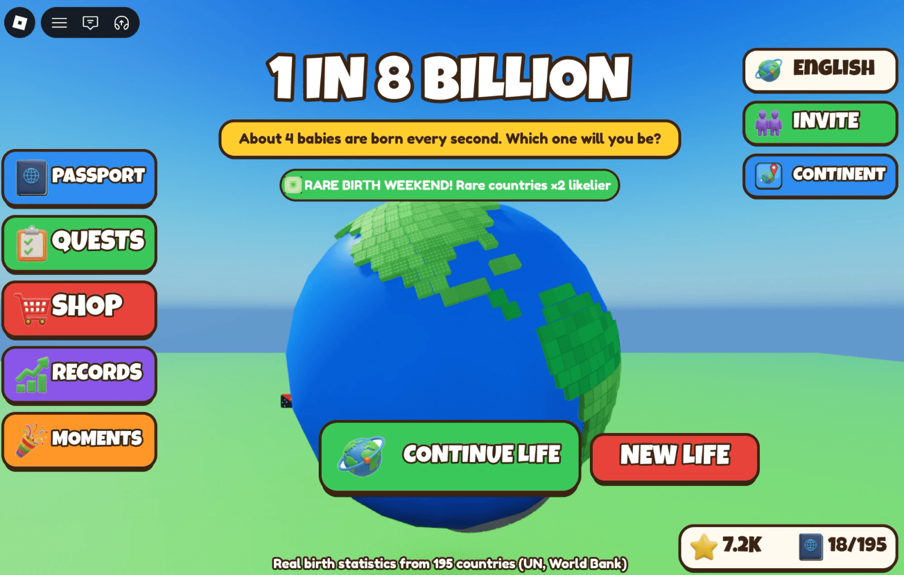
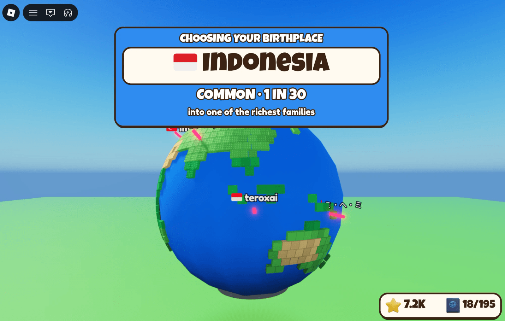
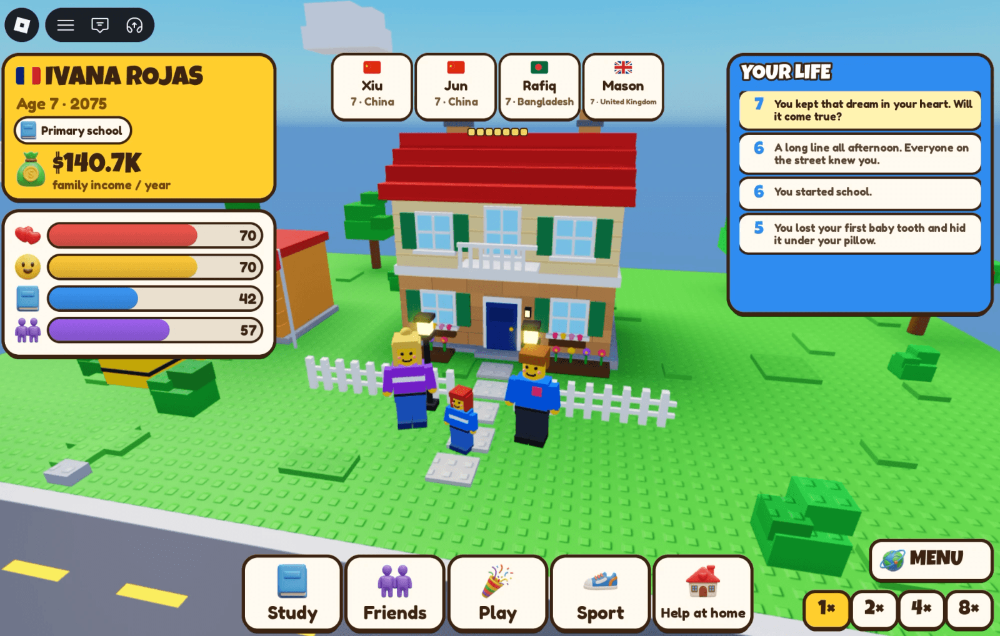
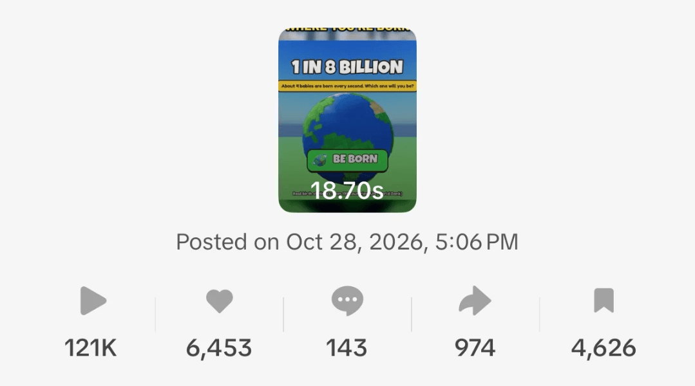
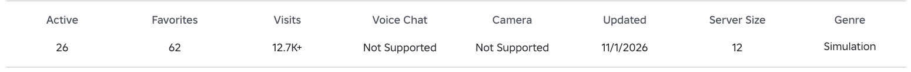
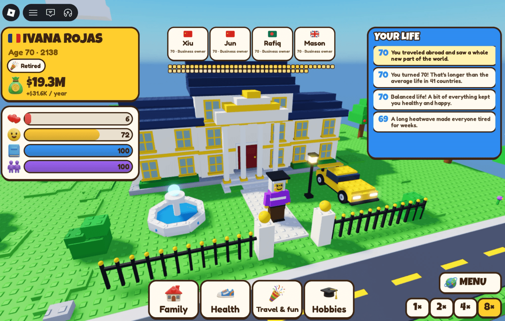

I make apps for the Mac and the iPhone. Last week I made a Roblox game, mostly out of curiosity. It took two days from the idea to the release, and in its first five days it got more than 12,700 visits.

This is how it went: what the AI did, what I had to fix myself, and where the players came from.

## The idea

I had heard people talk about a browser game where you are born as one random baby out of eight billion and see what kind of life you get. Someone close to me who plays Roblox asked whether that could work there. I thought a simpler version could.

The result is [Born As: 1 in 8 Billion](https://www.roblox.com/games/89739743403211). You spin a birth wheel with real odds for 195 countries: India comes up about one time in six, San Marino about one time in 900,000. Then you live a whole life in a few minutes, school, work, love, family, maybe a move abroad, and four other babies are born at the same moment as you, including real players on your server.

The birth numbers come from open data of the UN and the World Bank, and the game says so on screen.

## Two days, with Roblox Studio connected to Claude

I connected Roblox Studio to Claude through its MCP server, so the agent could read and change the game directly. It wrote the code in Luau, built the interface and did the translations. The pictures for the store page and the thumbnails I made in a different AI tool.

Two days sounds fast, and it was. It does not mean the AI made the game while I watched.

## What the AI could not see

The agent knows what a good interface looks like in general. It does not see the result. Buttons overlapped, some were far too small, some kept the default look. The logic had holes too.

The fix was simple and boring: I looked at the screen and told it exactly what was wrong. "This button is too small." "These two overlap." Once it was told, it fixed the problem and usually understood the rule behind it.

The biggest miss was mobile. The agent tested everything on a PC. We had agreed to release on phones and consoles too, so after the release I opened the live game on a phone. Everything was tiny and crooked. That was a round of fixes after launch, with players already in the game.

The lesson is the same as with my apps: the AI writes fast, a person has to look at every screen on every device.

## Where the players came from

Almost all of them came from TikTok. I made [an account for the game](https://www.tiktok.com/@roblox_games_dragon) and posted short clips. One of them took off: 121,000 views, 6,453 likes and 974 shares, and 130 people followed the account from that one video.

People did not only watch. They wrote in the comments: thank you, great game, how do I find it. Some reported bugs, and I fixed them the same day. The community helped more than I expected.

After five days the game had 12,700 visits, 32 likes and 3 dislikes, 62 favorites, and the badge for being born had been won almost 7,000 times.

## The part nobody tells you: kids under 16

A new Roblox game is not open to everyone. At first it is shown only to players who have confirmed they are 16 or older. Most of the people who play Roblox are younger, so this matters a lot.

To open the game to younger players, Roblox asks for a few things. The account needs a verified ID and two-step verification. The game needs a content rating from Roblox's questionnaire; mine is Minimal, suitable for everyone. Then you either keep a Roblox Plus or Premium subscription for two months, or pay a one-time publishing fee per game. I paid the fee: 1,000 Robux, about 12 euros. Roblox says the fee is refunded 90 days after the game becomes eligible.

And then the game has to earn it. It needs 250 unique plays from what Roblox calls highly engaged players within 60 days. Those are older, active accounts that have spent time in the game and made a purchase somewhere on Roblox. TikTok views do not count by themselves, these players have to come and stay. The exact rules are on Roblox's [Kids and Select page](https://create.roblox.com/docs/production/publishing/kids-and-select), and they change, so check them before you plan around them.

## Made with AI?

Out of hundreds of comments, two said the game was made with AI. I understand where that comes from, but I do not agree with what it implies.

For me "made with AI" means one prompt and a release. That is not what happened. I decided what the game is, checked every screen, found the bugs, tested on devices and answered the players. The AI did the typing. That is not a reason for shame, it is the reason one person can ship a game in two days.

## How a Roblox game makes money

Roblox has a few ways to sell things inside a game, and the game uses them: one-time purchases, like being born again or being born in a chosen country, passes that stay with you, and since this week a monthly club. I do not publish the numbers, as in every article here. It is small, and it started in the first days.

## If you want to try

1. Connect Roblox Studio to your AI agent, so it works on the real game and not on copied code.
2. Start with an idea that is simple to explain in one sentence. Mine fits on the start screen.
3. Look at every screen yourself and say exactly what is wrong. The agent does not see the result.
4. Test on a phone before the release. Most Roblox players are on phones.
5. Make a short clip of the most surprising moment. For me that was the birth wheel landing on a rare country.
6. Read the comments and fix the bugs fast. Early players notice.
7. Plan for the 16+ start: a new game is shown to older players first, and opening it to kids takes verification, a fee or subscription and 250 highly engaged players.

## Questions people ask

### Can you make a Roblox game with AI?

Yes. With Roblox Studio connected to an AI agent, the agent can write the Luau code, build the interface and translate the game. You still have to design it, check every screen and test on each device. My game took two days from idea to release.

### What does the AI do badly in Roblox games?

It does not see the result. Buttons overlap, sizes are off, and it tends to test only on a PC. Once you point out the exact problem, it fixes it.

### How long does it take to make a Roblox game with AI?

A simple game can be released in a couple of days. Expect another round of fixes after the release, especially for phones.

### How do you get the first players for a Roblox game?

For me it was TikTok: short clips of the most surprising moment in the game. One clip with 121,000 views brought almost all the early players.

### Can kids under 16 play a new Roblox game right away?

No. A new game is shown to age-checked players who are 16 or older first. To open it to younger players you need ID verification, two-step verification, a fitting content rating, a Plus or Premium subscription or a refundable publishing fee, and 250 unique plays from highly engaged players within 60 days.

### How do Roblox games make money?

Through purchases inside the game: one-time products, passes and subscriptions, paid in Robux.
